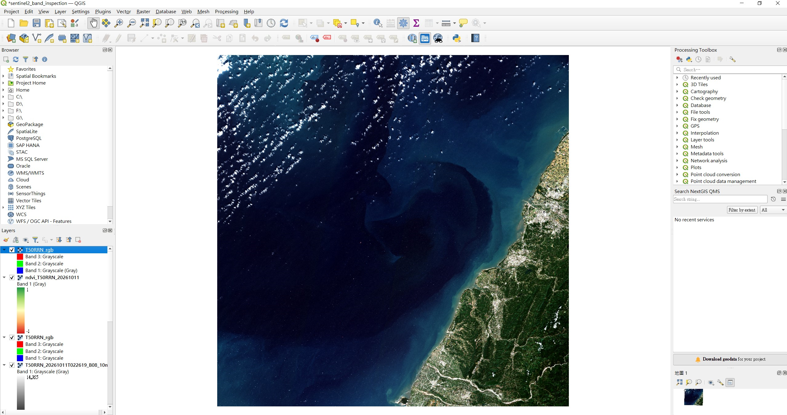
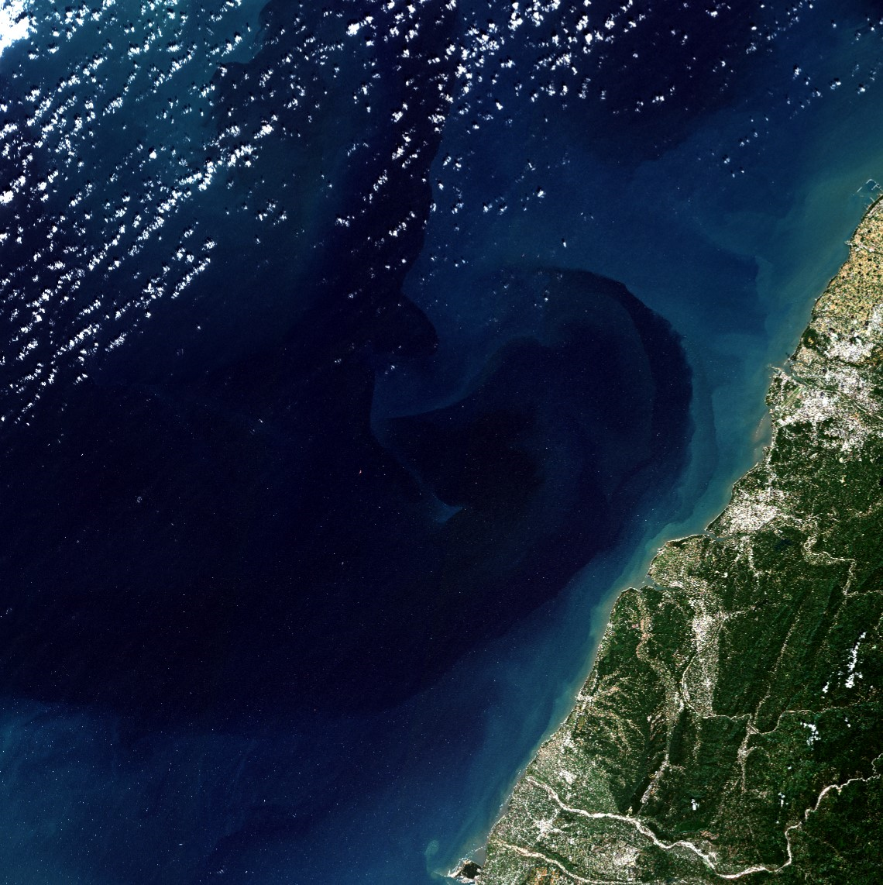
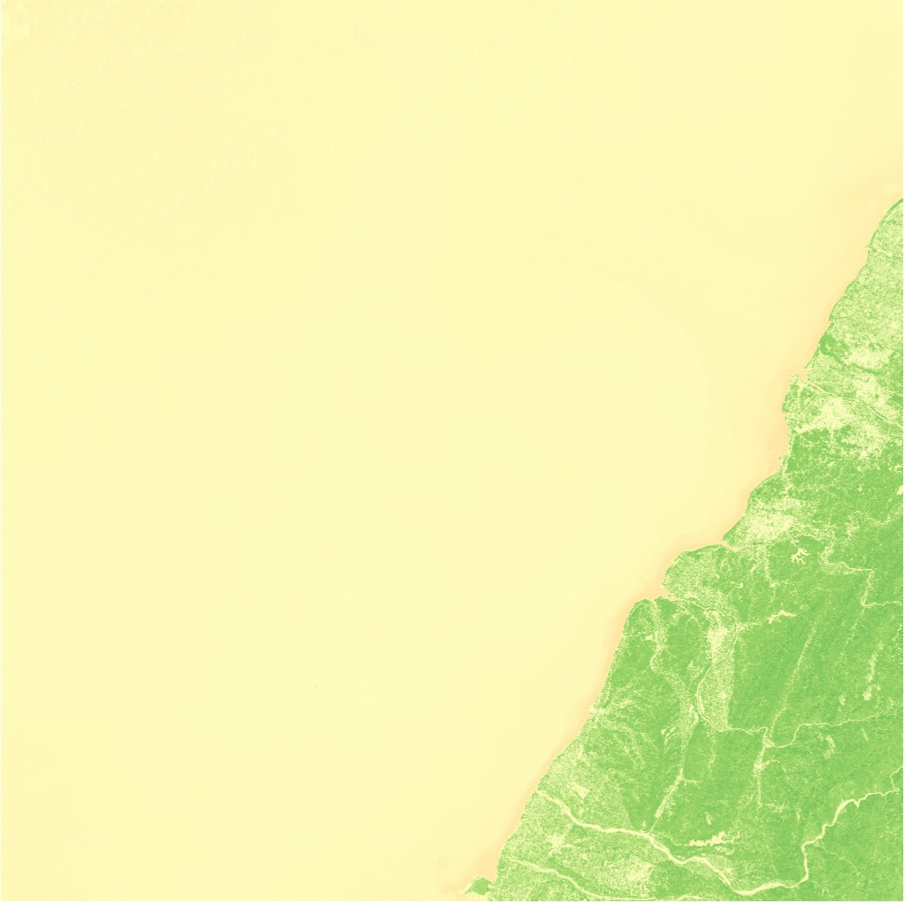
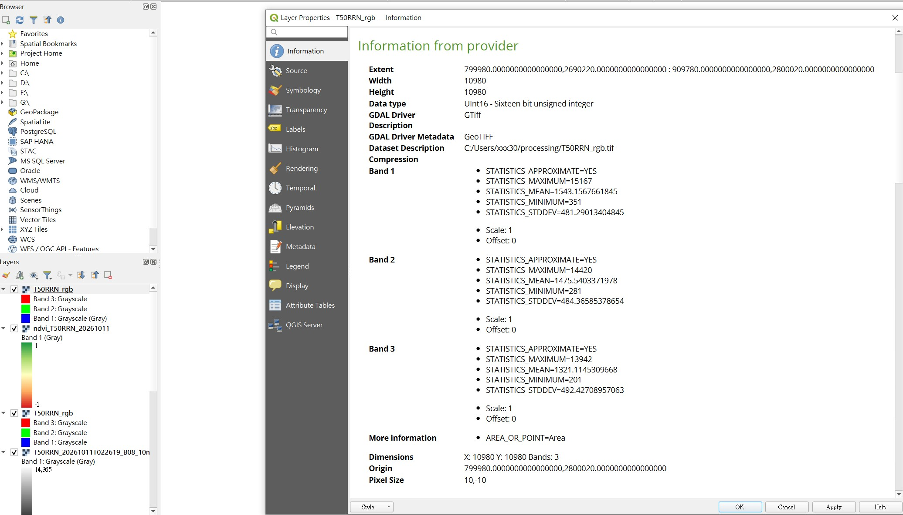
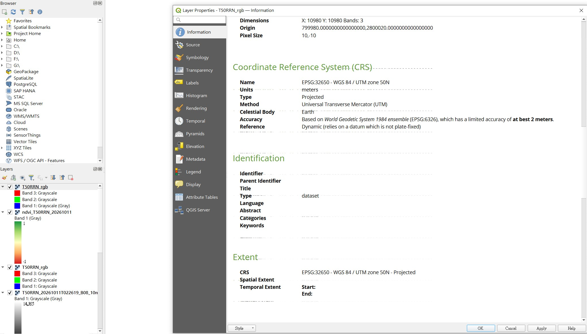

# Sentinel-2 Satellite Image Quality Assessment & NDVI Analysis

以 Python、Rasterio 與 NumPy 建立的 Sentinel-2 衛星影像分析工具，
包含波段品質統計、NDVI 計算、GeoTIFF 輸出及自動化測試。

## Features

- Inspect raster dimensions, CRS, spatial resolution and data types.
- Calculate pixel statistics for Sentinel-2 B02, B03, B04 and B08.
- Process large raster images using window-based reading.
- Export per-band statistics to CSV.
- Calculate NDVI from the red band (B04) and near-infrared band (B08).
- Export NDVI as a georeferenced Float32 GeoTIFF.
- Validate core calculations and output metadata with pytest.

## Technology Stack

- Python
- Rasterio
- NumPy
- pytest
- QGIS

# Sentinel-2 衛星影像品質檢查與 NDVI 植生指數分析

本專案使用 Python 建立 Sentinel-2 衛星影像分析工具，整合多波段影像品質統計、NDVI 植生指數計算、GeoTIFF 輸出與自動化測試，並透過 QGIS 驗證地理空間資料及視覺化分析結果。

## 一、專案功能

- **影像資訊檢查：** 檢查衛星影像尺寸、座標參考系統（CRS）、空間解析度及資料型別。
- **多波段品質統計：** 分析 B02、B03、B04、B08 波段的有效像素數量、零值數量、最小值、最大值與平均值。
- **大型影像分塊處理：** 使用 Rasterio Window 分塊讀取影像，降低大型 Raster 資料處理時的記憶體需求。
- **品質報告匯出：** 將各波段的統計結果輸出為 CSV，方便檢視與後續分析。
- **NDVI 植生指數計算：** 利用紅光波段 B04 與近紅外光波段 B08 計算 NDVI。
- **GeoTIFF 輸出：** 將 NDVI 結果輸出為具有地理參考資訊的單波段 Float32 GeoTIFF。
- **自動化測試：** 使用 pytest 驗證 NDVI 計算、無效資料處理、分母為零的情況及輸出影像的地理資訊。
- **GIS 視覺化：** 使用 QGIS 顯示 NDVI 分析結果，檢查影像空間資訊與視覺化成果。

## 二、使用技術

| 技術 | 用途 |
|---|---|
| Python | 資料處理與分析程式 |
| Rasterio | Raster 影像讀取、分塊處理及 GeoTIFF 輸出 |
| NumPy | 陣列運算與 NDVI 計算 |
| pytest | 自動化測試 |
| QGIS | 地理空間資料檢視與 NDVI 視覺化 |

## 三、使用的衛星影像

本專案使用 Sentinel-2 影像的四個波段：

| 波段 | 波段名稱 | 空間解析度 |
|---|---|---|
| B02 | 藍光（Blue） | 10 公尺 |
| B03 | 綠光（Green） | 10 公尺 |
| B04 | 紅光（Red） | 10 公尺 |
| B08 | 近紅外光（Near Infrared） | 10 公尺 |

原始影像尺寸為 `10980 × 10980` 像素，座標參考系統為 `EPSG:32650`。

請將四個 JP2 波段檔案放入以下目錄：

`data/real_satellite/T50RRN_20261011T022619/`

原始衛星影像因檔案容量較大，不包含於本專案的 Git 儲存庫中。

## 四、安裝環境

建議使用 Python 虛擬環境管理專案依賴。

安裝所需套件：

```bash
python -m pip install -r requirements.txt
```

## 五、執行方式

### 功能一. 檢查影像資訊

使用 `check_vrt.py` 檢查 VRT 虛擬影像的基本資訊與可讀取性，包括波段數、座標參考系統（CRS）、空間解析度、影像尺寸及資料讀取狀態。

#### 可選參數

| 參數 | 說明 | 預設值 |
|---|---|---|
| `--vrt` | 指定要檢查的 VRT 檔案路徑 | `data/real_satellite/T50RRN_rgb.vrt` |
| `--help` | 顯示命令列參數說明 | 無 |

#### 執行範例

**1. 使用預設路徑檢查 VRT**

```bash
python check_vrt.py
```

**2. 指定其他 VRT 檔案**

```bash
python check_vrt.py --vrt "data/real_satellite/another_image.vrt"
```

**3. 指定其他資料夾中的 VRT 檔案**

```powershell
python check_vrt.py --vrt "D:\Satellite\T50RRN_rgb.vrt"
```

**4. 查看可用參數**

```bash
python check_vrt.py --help
```

#### 檢查項目

- **波段數：** 確認 VRT 是否包含 3 個波段。
- **座標系統：** 確認影像是否具有 CRS。
- **空間解析度：** 確認 X、Y 方向的解析度是否皆為 10 公尺。
- **影像尺寸：** 確認影像寬度與高度皆大於 0。
- **資料讀取狀態：** 讀取部分像素，確認影像資料可以實際讀取。

程式會逐項輸出 `PASS` 或 `FAIL`，並顯示最終檢查結果。

### 功能二. 匯出波段品質統計報告

使用 `export_quality_report.py` 分析 Sentinel-2 影像的 B02、B03、B04、B08 四個波段，統計有效像素、零值像素、像素值範圍及平均值，並將分析結果匯出為 CSV 報告。

#### 可選參數

| 參數 | 說明 | 預設值 |
|---|---|---|
| `--image-dir` | 指定包含 Sentinel-2 波段影像的資料夾 | `data/real_satellite/T50RRN_20261011T022619` |
| `--output` | 指定 CSV 報告的輸出路徑及檔名 | `reports/pixel_quality_report.csv` |
| `--window-size` | 指定分塊處理的視窗大小，必須大於 0 | `512` |
| `--overwrite` | 允許覆寫已存在的報告檔案 | 未指定時不允許覆寫 |

#### 執行範例

**1. 使用預設設定**

```bash
python export_quality_report.py
```

使用預設影像資料夾與分塊大小，分析四個波段並產生 CSV 報告。

**2. 指定影像資料夾**

```powershell
python export_quality_report.py --image-dir "D:\Satellite\T50RRN_20261011T022619"
```

分析指定資料夾中的 B02、B03、B04、B08 波段影像。

**3. 指定報告輸出路徑**

```powershell
python export_quality_report.py --output "D:\Satellite\reports\quality_report.csv"
```

將品質統計報告輸出至指定位置。

**4. 調整分塊處理大小**

```bash
python export_quality_report.py --window-size 1024
```

將處理視窗大小由預設的 `512 × 512` 調整為 `1024 × 1024` 像素。較大的視窗可能提高單次處理效率，但也會增加記憶體使用量。

**5. 指定影像資料夾、輸出路徑與分塊大小**

```bash
python export_quality_report.py --image-dir "data/real_satellite/T50RRN_20261011T022619" --output "reports/quality_report.csv" --window-size 1024
```

可同時指定輸入資料夾、輸出檔案及分塊處理大小。

**6. 允許覆寫既有報告**

```bash
python export_quality_report.py --overwrite
```

當預設輸出位置已有同名報告時，允許覆寫該檔案。

#### 預設輸出

未指定 `--output` 時，預設輸出至：

```text
reports/pixel_quality_report.csv
```

報告以 CSV 格式保存，方便使用 Excel 或其他資料分析工具檢視與整理。

### 功能三. 計算 NDVI 植生指數

使用 `calculate_ndvi.py` 計算 Sentinel-2 的 NDVI（Normalized Difference Vegetation Index），並將結果輸出為 GeoTIFF 格式。

#### 可選參數

| 參數 | 說明 | 預設值 |
|---|---|---|
| `--image-dir` | 指定包含 Sentinel-2 波段影像的資料夾 | `data/real_satellite/T50RRN_20261011T022619` |
| `--output` | 指定 NDVI 輸出檔案的完整路徑或相對路徑 | `outputs/ndvi/ndvi_T50RRN_20261011.tif` |
| `--window-size` | 指定分塊處理的視窗大小，必須大於 0 | `512` |
| `--overwrite` | 允許覆寫已存在的輸出檔案 | 未指定時不允許覆寫 |

#### 執行範例

**1. 使用預設設定**

```bash
python calculate_ndvi.py
```

使用預設影像資料夾、視窗大小與輸出路徑執行 NDVI 計算。

**2. 指定完整輸出路徑**

```powershell
python calculate_ndvi.py --output "D:\Satellite\results\my_ndvi.tif"
```

將計算結果輸出至指定位置。若目標資料夾不存在，程式會建立所需的父資料夾。

**3. 指定相對輸出路徑**

```bash
python calculate_ndvi.py --output "outputs/ndvi/my_ndvi.tif"
```

將結果輸出至專案目錄下的 `outputs/ndvi/` 資料夾。

**4. 調整分塊處理大小**

```bash
python calculate_ndvi.py --window-size 1024
```

將處理視窗大小由預設的 `512 × 512` 調整為 `1024 × 1024` 像素。

**5. 指定輸出路徑並允許覆寫**

```bash
python calculate_ndvi.py --output "outputs/ndvi/my_ndvi.tif" --overwrite
```

當輸出檔案已存在時，允許覆寫該檔案。

#### 預設輸出

未指定 `--output` 時，預設輸出至：

```text
outputs/ndvi/ndvi_T50RRN_20261011.tif
```

輸出為單波段 Float32 GeoTIFF，包含 NDVI 計算結果及相應的空間參考資訊。

可使用 QGIS 開啟 GeoTIFF，並透過單波段偽彩色（Singleband pseudocolor）顯示 NDVI 分布。

### 功能四. 執行自動化測試

```bash
python -m pytest tests/test_ndvi.py -v
```

目前已完成六項測試，涵蓋：

1. NDVI 公式計算正確性。
2. 分母為零時的處理。
3. 無效像素遮罩的處理。
4. NaN 與無限大等非有限數值的處理。
5. 輸入波段陣列尺寸不一致時的錯誤處理。
6. 輸出 GeoTIFF 的座標系統、解析度、尺寸、資料型別與 NoData 設定。

目前六項測試均已通過。

## 六、NDVI 計算方法與本次測試結果

NDVI（Normalized Difference Vegetation Index，正規化差異植生指數）是一種常見的遙測植生指標，利用紅光與近紅外光的反射率差異，協助觀察地表植被的相對綠度。

計算公式如下：

\[
NDVI = \frac{B08-B04}{B08+B04}
\]

其中：

- B08：近紅外光波段。
- B04：紅光波段。

NDVI 一般介於 -1 至 1。較高的正值常見於較茂盛的植被，但實際解讀仍需考量地表類型、觀測條件及影像品質。

輸出影像使用 `Float32` 資料型別，並以 `-9999` 作為輸出 NoData 標記。當來源遮罩無效、輸入包含非有限數值或計算分母為零時，程式會將相應像素標記為無效。
NDVI 分析結果

本專案使用 Sentinel-2 的 B04 紅光波段與 B08 近紅外線波段計算 NDVI，影像尺寸為 10,980 × 10,980，共處理 120,560,400 個有效像素。

本次分析結果的 NDVI 範圍為 -1.0 至 1.0，平均值約為 0.0592。整體平均值偏低，可能反映分析區域包含較多非植生地表。實際植被分布仍需搭配 NDVI 空間分布圖、土地覆蓋資訊及影像品質進一步判讀。

目前分析尚未進行雲、雲影及積雪遮罩，因此統計結果可能受到這些因素影響。

## 七、目前成果與限制

### 已完成

- 四個 Sentinel-2 波段的像素統計與 CSV 報告。
- 以分塊方式處理大型衛星影像。
- NDVI 計算與 GeoTIFF 輸出。
- 輸出影像的座標系統、解析度與尺寸驗證。
- 六項 pytest 自動化測試。
- 透過 QGIS 成功顯示 NDVI 彩色圖層。

### 目前限制

- 尚未實作雲、雲影及雪的自動遮罩。
- 原始 JP2 影像目前沒有明確設定 NoData 值，因此現有有效像素比例不能直接代表所有像素都是有效的地表觀測。
- 目前的 NDVI 結果尚未排除雲與雲影的影響，不宜直接將整張影像的平均 NDVI 解讀為植被覆蓋率。
- 自動化測試目前以核心計算與既有輸出檔案的驗證為主，後續仍有擴充空間。

## 八、未來改進方向

- 整合 Sentinel-2 Scene Classification Layer（SCL），進行雲、雲影與雪的品質遮罩。
- 擴充真實影像的無效資料判定與品質檢查。
- 增加 NDVI 統計報告與視覺化成果匯出。
- 擴充自動化測試及錯誤處理。
- 整理 QGIS 分析截圖與可重現的執行流程。    

## 九、專案目的

本專案旨在建立一套可重現的衛星影像分析流程，展示 Python 在遙測資料處理、Raster 品質統計、植生指數計算、地理空間資料輸出及自動化測試上的實務應用。

## 十、成果展示

1. Sentinel-2 真彩色影像

   使用 Sentinel-2 B02、B03、B04 波段建立 RGB 真彩色影像，並透過 QGIS 檢視影像內容。



2. NDVI 植生指數
   
   使用 B04（Red）與 B08（NIR）波段計算 NDVI，輸出 GeoTIFF，並於 QGIS 中進行視覺化。



3. 影像空間資訊

   透過 QGIS 檢視影像的座標參考系統、空間解析度及影像尺寸，確認輸出資料的基本空間資訊。





